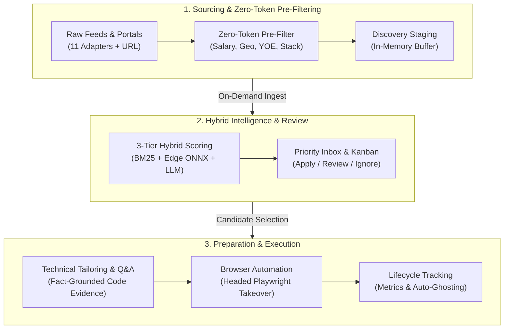

#  Vanguard

**A local-first, human-in-the-loop Developer Career Cockpit & Application Assistant for software engineers.**

Vanguard is an intelligent career scouting and application preparation cockpit built specifically for software engineers and technical practitioners. It eliminates the operational friction of technical job hunting without relinquishing human agency or hallucinating candidate credentials.

---



---

## Key Principles & System Invariants

- **Local-First Persistence**: SQLite (`pulse.db`) via Prisma 7 and the LibSQL adapter acts as the single source of truth. Runs entirely on your machine with zero cloud database dependencies.
- **Developer-First Domain Precision**: BM25 tokenizers and ONNX embeddings preserve programming symbols and tech terms (`C++`, `C#`, `.NET`, `Node.js`, `TypeScript`, `Go`, `Rust`, `Kubernetes`). Deterministic pre-filters enforce technical stack density, match engineering seniority levels (`SDE 1/2/3`, `Staff`, `Principal`), and eliminate non-technical roles.
- **Zero-Cost Cascading Inference**: Operates at ₹0/month through a 7-tier provider cascade (Gemini Pro/Paid, Gemini Free Multi-Model, NVIDIA NIM, Ollama Cloud, OpenRouter Free Ranked, Groq Fallback, OpenRouter Global Free Router) with zero-latency circuit breakers, Power-of-Two-Choices (P2C) key balancing, and proactive rate-limit tracking.
- **Zero-Token Local Hybrid Scoring**: Edge ONNX dense embeddings and BM25 ranking execute entirely in-process with 0 API tokens and zero external network latency.
- **Zero-Token Raw Discovery**: Ingestion, cross-aggregator deduplication, and 6-dimension regex pre-filtering consume 0 AI tokens.
- **No Hallucinated Credentials**: All resume tailoring and application portal answers strictly project from verified candidate profile facts and code repositories.
- **Human-in-the-Loop Execution**: Administrative ingestion, pre-filtering, scoring, drafting, and form mapping are automated; final application submissions remain strictly human-initiated.

---

## Core Capabilities

### 1. Ingestion, Feed Adapters & Deduplication *(Beta)*

> [!NOTE]
> Multi-source feed ingestion and third-party adapters are currently in active Beta testing and subject to ongoing edge-case hardening.

- **11 Deterministic Feed Adapters**: Native scheduled and on-demand synchronization across Ashby, Greenhouse, Lever, HiringCafe, Wellfound, Himalayas, RemoteOK, Jobicy, We Work Remotely, Indeed RSS, and top-level Hacker News "Who is hiring?" posts (with conversational noise rejection and header parsing).
- **Direct & URL Ingestion**: Ingest raw postings via manual paste or direct URL import with automatic compensation and currency normalization (LPA, symbols, multi-currency conversion).
- **Dual-Mode Candidate Parser**: Import candidate resumes via deterministic Markdown AST parsing with structured AI fallback.
- **Cross-Aggregator Clustering**: Computes a deterministic `dedupeKey` (company + title + URL tokens) and a cross-board `clusterKey` (company + title) to group duplicate listings across multiple job boards.

---

### 2. Zero-Token Multi-Dimension Pre-Filter & Discovery Staging

Before consuming any AI inference tokens, incoming jobs pass through strict deterministic regex constraints:

- **Salary Floor**: Evaluates normalized compensation ceilings against candidate minimum requirements with cross-currency conversion.
- **Strict Location & Remote Policy**: Domestic roles permit remote, hybrid, or onsite; international postings strictly enforce unrestricted/worldwide remote requirements (rejecting international onsite/hybrid and explicit foreign geo-restrictions like "US Only").
- **YOE & Seniority Bounds**: Compares candidate experience against job requirements with tolerance bounds, automatically rejecting roles requiring excessive experience and filtering out Senior/Staff/Lead titles for junior and mid-level candidates ($C \le 3$ years).
- **Role Precision ("To a T")**: Enforces target role keyword matching, domain blacklist rejection, and minimum tech stack keyword density ($\ge 2$ matching skills).
- **Discovery Staging Buffer**: Filter-passing discovered jobs stage in a dedicated, high-speed buffer with synchronous in-memory source filtering and non-destructive transitions. AI scoring is never run on raw batches; scoring triggers on-demand when ingesting into the Priority Inbox.

---

### 3. Three-Tier Local Hybrid Scoring Funnel

Vanguard evaluates candidate-job fit using a staged funnel that maximizes precision while keeping token expenditure at zero for clear matches and mismatches:

| Funnel Tier | Engine | Latency | AI Token Cost | Role / Decision |
| :--- | :--- | :--- | :--- | :--- |
| **Tier 1: Lexical** | Okapi BM25 (`k1=1.5, b=0.75`) | $< 1\text{ ms}$ | 0 tokens | Symbol-preserving technical tokenization (`C++`, `.NET`, `Node.js`, `TypeScript`, `Go`, `Rust`) |
| **Tier 2: Dense Semantic** | Edge ONNX Embeddings (`bge-small-en-v1.5`) | $\sim 15\text{ ms}$ | 0 tokens | 384-dimensional dense vector embeddings executed 100% locally in Node.js |
| **Tier 3: Selective LLM** | Workload Cascading AI Router | $1\text{--}3\text{ s}$ | Free-Tier Pool | Deep 4D reasoning (Skills, Experience, Domain, Trajectory) for borderline roles |

#### Funnel Routing Thresholds:
- **Score $< 55$**: `AUTO_IGNORE` — Mismatches discarded immediately at 0 AI token cost.
- **Score $\ge 82$**: `AUTO_STAGE_HIGH_MATCH` — Strong matches staged immediately at 0 AI token cost.
- **Score $55\text{--}81$**: `SELECTIVE_LLM_DEEP_INSPECTION` — Borderline opportunities routed to LLM for comprehensive reasoning.

#### Token Optimization & Feedback:
- **Deterministic Tier Caching**: Content-addressed SHA-256 L1 cache with 7-day TTL delivers instant $0\text{ ms}$ re-evaluation at 0 tokens.
- **Boilerplate Distillation**: Automatically strips 60–70% of non-functional text (EEO statements, legal disclaimers) prior to prompt construction.
- **Adaptive Outcome Feedback**: Calibrates scoring weights across candidate lifecycle outcomes with phased Bayesian guardrails (Phase 0 static, Phase 1 suggestions, Phase 2 clamped automated drift).

---

### 4. Fact-Grounded Technical Resume Tailoring & Q&A

- **Context-Aware Technical Resume Tailoring**: Generates tailored markdown resumes selecting and ranking the most relevant code repositories, system architectures, verified skills, and production metrics.
- **Technical Screening Q&A Synthesis**: Generates portal responses grounded strictly in verified engineering evidence, project architectures, and candidate facts—eliminating generic LLM clichés and hallucinations.

---

### 5. Assisted Browser Automation & Form Mapping *(Beta)*

> [!NOTE]
> Assisted browser automation and ATS form auto-fill heuristics are currently in active Beta testing across live portal environments.

- **Two-Tier ATS Form Mapper**: Heuristic classification with deep fallback to map interactive form fields across modern ATS platforms (Greenhouse, Lever, Ashby, Workday).
- **Persistent Playwright Runner**: Launches headed browser sessions with automated profile management, keystroke emulation, and direct PDF resume attachment.
- **Visual Inspection & Takeover**: Injects non-destructive CSS inspection badges, scrolls directly to missing required fields, and hands off control for manual review and human submission.
- **Real-Time SSE Streaming**: Live progress streaming directly to the cockpit interface with hybrid submission detection.

---

### 6. Full Lifecycle State Machine, Job Management & Auto-Ghosting

- **Stage Progression**: State machine tracking `DRAFT` &rarr; `SHORTLISTED` &rarr; `PREPARED` &rarr; `APPLIED` &rarr; `SCREENING` &rarr; `ASSESSMENT` (Take-home / OA) &rarr; `INTERVIEW` (Technical / System Design) &rarr; `OFFER` / `REJECTED` / `WITHDRAWN` / `GHOSTED`.
- **Kanban & Pipeline Cards**: High-density Kanban pipeline with native HTML5 drag-and-drop, stage transition audit history, and direct job deletion actions across pipeline cards and Cockpit views.
- **Metrics & Latency Tracking**: Tracks submission timestamps, first response latency (`responseTimeDays`), and granular rejection stages/reasons.
- **Automated Ghost Detection**: Identifies stale applications (14 days) and automatically transitions unresponded applications to `GHOSTED` after 21 days.

---

## Tech Stack

- **Framework**: Next.js 16 (App Router), React 19
- **Styling**: Tailwind CSS v4, Lucide Icons, Radix UI Primitives
- **Database & ORM**: SQLite (`pulse.db`), Prisma 7 with `@prisma/adapter-libsql`
- **AI & LLM**: Vercel AI SDK (`ai`), `@ai-sdk/google` (Gemini), `@ai-sdk/openai` (NVIDIA NIM, Ollama Cloud, OpenRouter, Groq)
- **Local ML & Embeddings**: `@huggingface/transformers` (Transformers.js v3, ONNX runtime, `Xenova/bge-small-en-v1.5`)
- **Browser Automation**: Playwright (headed persistent contexts)
- **Language & Runtime**: TypeScript 5, Node.js

---

## Getting Started

### 1. Clone & Install

```bash
git clone https://github.com/Achyuth072/Vanguard.git
cd Vanguard
npm install
```

### 2. Configure Environment

Copy the example environment file:

```bash
cp .env.example .env
```

Configure your API keys in `.env` (supports comma-separated keys and models for automatic matrix rotation and 429 failover):

```env
# Google Gemini (Tier 0 & Tier 1)
GEMINI_API_KEY="AIzaSy_KEY1,AIzaSy_KEY2"
GEMINI_MODEL="gemini-3.8-flash,gemini-3.7-flash,gemini-3.6-flash,gemini-3.5-flash,gemini-3.5-flash-lite,gemini-3.1-flash-lite"

# NVIDIA NIM (Tier 2 - 40 RPM Free)
NVIDIA_API_KEY="nvapi-..."
NVIDIA_MODEL="z-ai/glm-5.3-flash,z-ai/glm-5.3,stepfun-ai/step-5-preview,deepseek-ai/deepseek-v4.1-flash,Nemotron 3.5 Super VL 120B A12B,moonshotai/kimi-k2.6"

# Ollama Cloud (Tier 3 - Hosted Open Models Pool)
OLLAMA_API_KEY="ollama_..."
OLLAMA_MODEL="beam,gemma4:31b,gpt-oss:120b,gpt-oss:20b,nemotron-3-nano:30b,nemotron-3-super,nemotron-3-ultra"

# OpenRouter (Tier 4 & Tier 6 - Free Models & Global Free Router)
OPENROUTER_API_KEY="sk-or-..."
OPENROUTER_MODEL="inclusionai/ling-3.1-flash,nvidia/nemotron-3.5-super-vl:free,nvidia/nemotron-3-ultra:free,nvidia/nemotron-3.5-lightning:free,google/gemma-4-31b-it:free"

# Groq (Fast Fallback)
GROQ_API_KEY="gsk_..."
GROQ_MODEL="llama-3.3-70b-versatile"
```

### 3. Initialize Database

Generate Prisma client and apply migrations:

```bash
npx prisma db push
npm run db:seed
```

### 4. Start Development Server

```bash
npm run dev
```

Open [http://localhost:3001](http://localhost:3001) to access the Vanguard dashboard.

---

## Quality & Verification

Run type verification and the automated test suite:

```bash
npx tsc --noEmit
npm test
```
