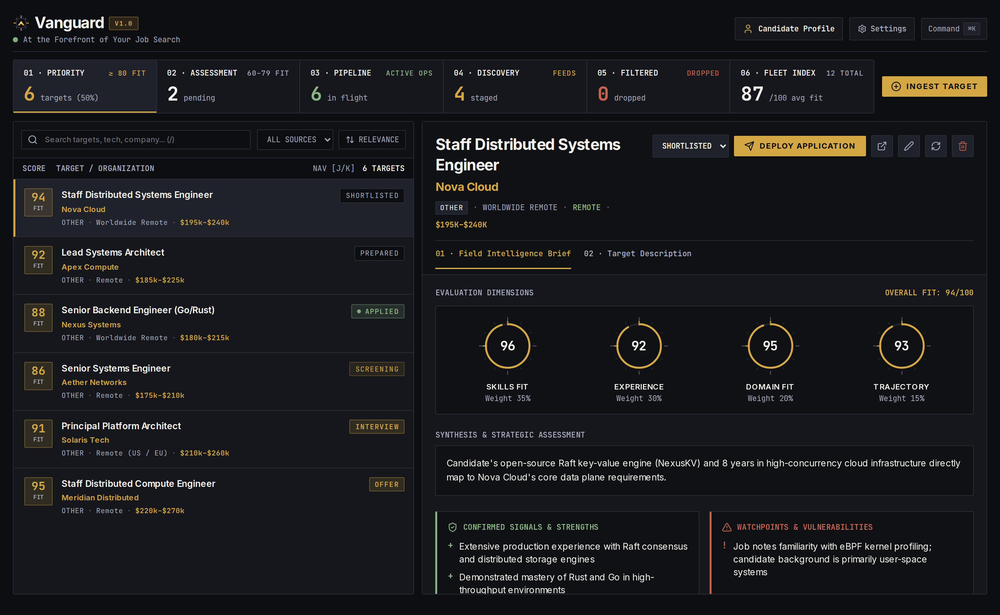
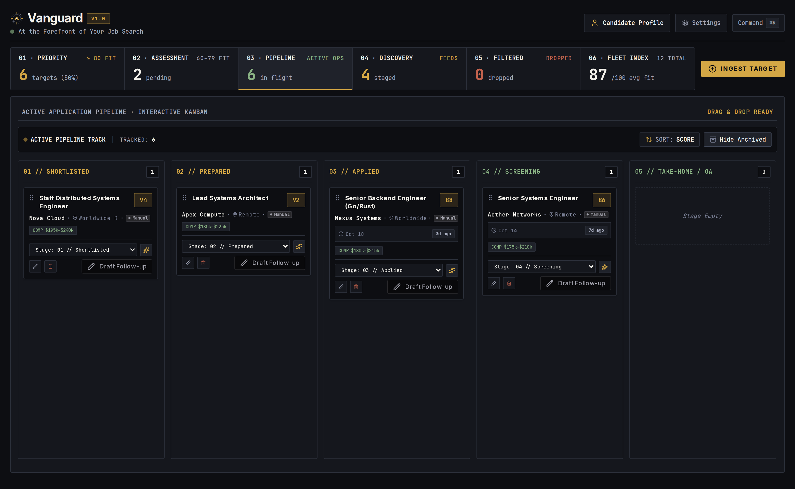
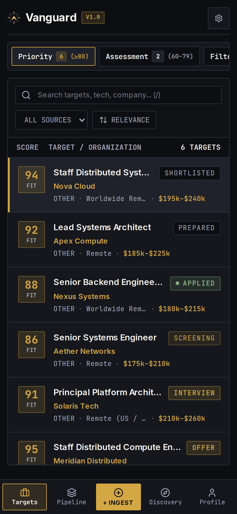
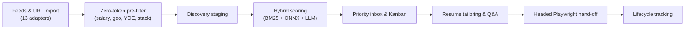

<div align="center">

  <a href="https://github.com/Achyuth072/Vanguard">
    
  </a>

  # Vanguard

  ### Local-first developer career cockpit

  Find, score, and prepare job applications from one place — with your data on your machine and the final submit button still yours.

  [](LICENSE)

</div>

<div align="center">
  
</div>

<br />

<table align="center" width="100%">
  <tr>
    <td align="center" width="67%"><b>Kanban pipeline</b></td>
    <td align="center" width="33%"><b>Mobile PWA</b></td>
  </tr>
  <tr>
    <td align="center" valign="top">
      
    </td>
    <td align="center" valign="top">
      
    </td>
  </tr>
</table>

---



---

<div align="center">

## Features

</div>

<div align="left">

- **13 feed adapters** — Ashby, Greenhouse, Lever, HiringCafe, Wellfound, Himalayas, RemoteOK, Jobicy, We Work Remotely, Indeed RSS, SmartRecruiters, Remotive, and Hacker News "Who is hiring?", plus manual paste and URL import. *(Beta)*
- **Zero-token pre-filtering** — deterministic gates on minimum salary, remote policy, years of experience, seniority, and tech-stack density run before any model is called.
- **Three-tier hybrid scoring** — in-process BM25, local ONNX embeddings (`bge-small-en-v1.5`), and a selective LLM pass only for borderline matches. Clear matches and mismatches resolve at zero token cost.
- **Free-tier model cascade** — Gemini, NVIDIA NIM, Ollama Cloud, OpenRouter, and Groq behind circuit breakers, key balancing, and rate-limit tracking.
- **Fact-grounded writing** — tailored markdown resumes and screening answers are projected from your verified profile and repositories, never invented.
- **Assisted form filling** — ATS field mapping with a headed Playwright session, live progress over SSE, and a manual review before submission. *(Beta)*
- **Full lifecycle tracking** — Kanban pipeline from `DRAFT` through `APPLIED`, `INTERVIEW`, and `OFFER`, with response-latency metrics and auto-ghosting of stale applications.
- **Local-only storage** — SQLite (`pulse.db`) via Prisma 7; the only network calls are the ones you configure for model providers.

</div>

<div align="center">

## Tech stack

</div>

<div align="left">

- **Framework**: Next.js 16 (App Router), React 19
- **Styling**: Tailwind CSS v4, Radix UI, Lucide
- **Data**: SQLite (`pulse.db`), Prisma 7 with `@prisma/adapter-libsql`
- **AI**: Vercel AI SDK, `@ai-sdk/google`, `@ai-sdk/openai`
- **Local ML**: `@huggingface/transformers` (Transformers.js v4, ONNX)
- **Automation**: Playwright (headed persistent contexts)
- **Language**: TypeScript 6, Node.js 22+

</div>

<div align="center">

## Getting started

### Docker

Copy the example environment, add at least one provider API key, then build:

</div>

<div align="left">

```bash
cp .env.example .env
docker compose up -d --build
```

</div>

<div align="center">

Open [http://localhost:3001](http://localhost:3001). The cockpit uses port `3001` so `3000` stays free; override with `VANGUARD_HOST_PORT`. Data persists in the `vanguard-data` volume at `/data/pulse.db`, and embeddings run locally from pre-baked ONNX weights.

</div>

<div align="center">

### Local development

Install dependencies and start the dev server:

</div>

<div align="left">

```bash
npm install
npm run dev
```

</div>

<div align="center">

Runs on [http://localhost:3002](http://localhost:3002) against the repo-local `./pulse.db`, a separate database from the Docker volume. Run `npx prisma db push` after a schema change; only the Docker entrypoint syncs schemas automatically.

</div>

<div align="center">

### Browser automation (host Chrome)

Vanguard can drive your desktop Chrome over CDP to reuse existing logins:

</div>

<div align="left">

1. Start Chrome with remote debugging:

   ```bash
   google-chrome --remote-debugging-port=9222 --user-data-dir="$HOME/.pulse-chrome"
   ```

2. Bridge loopback into the Docker network:

   ```bash
   node scripts/cdp-bridge.mjs
   ```

   To keep it running, install the bundled unit:

   ```bash
   mkdir -p ~/.config/systemd/user && cp scripts/cdp-bridge.service ~/.config/systemd/user/
   systemctl --user daemon-reload && systemctl --user enable --now cdp-bridge.service
   ```

3. Point Vanguard at it in `.env`:

   ```env
   PLAYWRIGHT_CDP_ENDPOINT="http://host.docker.internal:9333"
   ```

</div>

<div align="center">

### Private mobile access (Tailscale)

Access the cockpit from iOS or Android without opening firewall ports:

</div>

<div align="left">

1. Add `TS_AUTHKEY` to `.env`.
2. Launch with the Tailscale profile:

   ```bash
   docker compose -f docker-compose.yml -f docker-compose.tailscale.yml --profile tailscale up -d --build
   ```

3. Open `https://vanguard-cockpit.<your-tailnet>.ts.net` and install it as a PWA.

</div>

<div align="center">

## Development checks

Run type verification, the test suite, and live feed adapter probes:

</div>

<div align="left">

```bash
npx tsc --noEmit
npm test
npm run test:sources        # probe live feed adapter connectivity
npm run test:sources:all    # probe all adapters with live verification
```

</div>

<div align="center">

## Further reading

</div>

<div align="left">

- [Scoring & pre-filter pipeline](docs/scoring-pipeline.md) — pre-filter dimensions, funnel thresholds, token strategy
- [Domain context & glossary](CONTEXT.md)
- [Architecture decision records](docs/adr/)

</div>

<div align="center">

## License

Copyright © 2026 Achyuth

Vanguard is licensed under the [GNU Affero General Public License v3.0](LICENSE).

</div>
